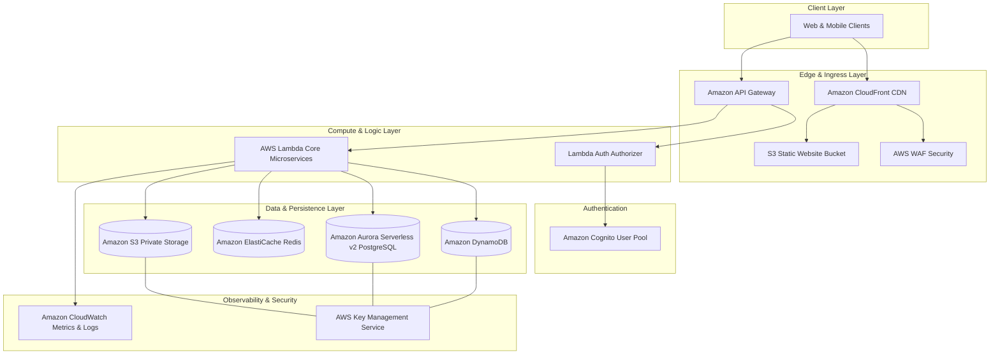
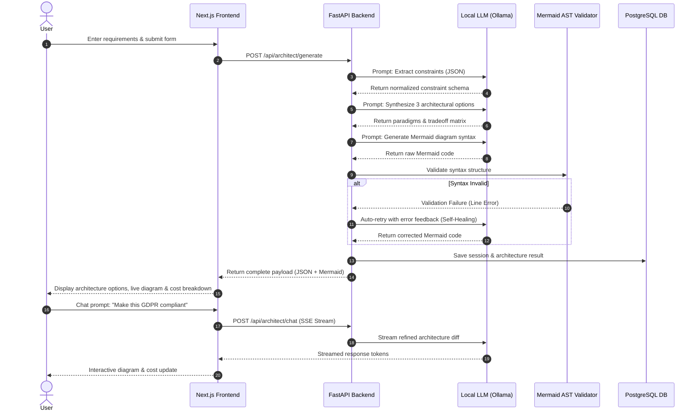

# AI-Powered Cloud Solution Architect

> **Document Version:** 1.0.0  
> **Target System:** AI-Powered Cloud Solution Architect Platform  
> **Scope:** Comprehensive Architecture Specification & Technical Solution Guide  

---

## 1. Problem Statement

Modern cloud platforms—such as Amazon Web Services (AWS), Microsoft Azure, and Google Cloud Platform (GCP)—offer over 200+ specialized services each. While this broad catalog provides immense flexibility, it introduces severe friction for software teams, early-stage startups, solo developers, and enterprise architects:

1. **The Cloud Expertise Gap**: Selecting optimal services requires deep experience across compute, networking, database paradigms, security, and pricing models. Non-expert developers frequently choose sub-optimal patterns (e.g., over-provisioned EC2 instances instead of serverless functions, or inappropriate database engines).
2. **Decision Paralysis & Tradeoff Overhead**: Evaluating complex tradeoffs between cost, operational complexity, security posture, and scalability ceilings requires significant manual analysis. Teams often stall during the infrastructure planning phase.
3. **High Architectural Consulting Costs**: Hiring certified cloud solution architects or external consultants costs between $150 to $300+ per hour, which is prohibitive for lean startup teams and indie hackers.
4. **Documentation & Infrastructure Artifact Bottlenecks**: Creating technical architecture diagrams, cost estimations, and security rationales is manual, time-consuming, and frequently neglected, leading to technical debt and compliance gaps prior to deployment.

---

## 2. Proposed Solution

The **AI-Powered Cloud Solution Architect** is an intelligent, self-hostable web platform that automates cloud infrastructure design. By leveraging natural language processing and structured constraint extraction driven by Large Language Models (LLMs), the platform transforms plain-English business requirements into validated, production-ready cloud architectures.

```
┌──────────────────────────┐      ┌──────────────────────────────┐      ┌──────────────────────────────┐
│ User Input               │      │ AI Recommendation Engine     │      │ Production Artifacts         │
│ - Text prompt            ├─────►│ - Constraint Extraction      ├─────►│ - Ranked Arch Paradigms      │
│ - Budget & SLA limits    │      │ - Multi-Option Synthesis     │      │ - Live Mermaid Diagrams      │
│ - Compliance requirements│      │ - Self-Healing Diagram Check │      │ - Cost & Security Breakdown  │
└──────────────────────────┘      └──────────────────────────────┘      └──────────────────────────────┘
```

### Key Solution Highlights:
- **Guided Natural Language Input**: Converts free-form project descriptions into canonical cloud constraint models.
- **Multi-Option Architectural Synthesis**: Generates 3 distinct, ranked architecture paradigms (e.g., Serverless-First, Container-Based, Managed IaaS/PaaS) with explicit tradeoff evaluations.
- **Automated Diagram Rendering**: Generates syntactically validated, interactive Mermaid.js diagrams representing visual component relationships.
- **Granular Cost & Security Analytics**: Calculates itemized monthly cost estimates and highlights security risks alongside mitigation steps.
- **Interactive Refinement via AI Chat**: Enables dynamic architecture updates through conversational prompts (e.g., *"Make this architecture GDPR compliant"* or *"Swap RDS for DynamoDB"*).

---

## 3. Project Objectives

- **Democratize Architecture Design**: Enable non-cloud-experts to produce enterprise-grade cloud designs in under **5 minutes**.
- **Guarantee Diagram Reliability**: Achieve a **95%+ first-pass validity rate** for generated visual diagrams through a self-healing LLM syntax validation loop.
- **Cost Transparency**: Provide accurate, itemized cost estimates split across compute, storage, networking, and security layers.
- **Privacy & Self-Hosting**: Ensure zero vendor lock-in and complete privacy by supporting local LLM execution via Ollama (Llama 3.1 / Mistral).
- **Extensible Exporting**: Generate exportable Markdown reports, Mermaid diagram files, JSON project specs, and draft Infrastructure-as-Code (IaC) templates.

---

## 4. User Requirements: Input to the Platform

The platform accepts both free-form natural language prompts and optional structured constraints to formulate the technical context.

| Input Category | Field Name | Description / Options | Example Value |
|---|---|---|---|
| **Free-Text Requirements** | `projectDescription` | Plain-English summary of application scope, features, and target users. | *"B2B SaaS platform for document processing with 10k daily active users and PDF OCR requirements."* |
| **Workload Type** | `appType` | Web Application, REST/GraphQL API, Mobile Backend, Real-Time Data Pipeline, IoT, E-Commerce. | `REST / Web Application` |
| **Traffic & Scale** | `expectedScale` | Requests/sec, Concurrent Users, Daily Active Users (DAU). | `10,000 DAU (~50 req/sec peak)` |
| **Data Storage Profile** | `dataType` | Relational (SQL), Document (NoSQL), Object Storage, Key-Value Cache, Time-Series. | `Relational + Object Storage` |
| **Budget Tier** | `budgetTier` | Micro (<$50/mo), Low ($50–$500/mo), Mid ($500–$5,000/mo), Enterprise (>$5,000/mo). | `Low ($50 - $500/mo)` |
| **Compliance Needs** | `compliance` | None, GDPR, HIPAA, PCI-DSS, SOC2. | `GDPR` |
| **Preferred Cloud / Region**| `cloudRegion` | Target cloud provider & region (AWS us-east-1, eu-west-1, etc.). | `AWS (eu-west-1)` |

---

## 5. AI Recommendation Engine

The AI Recommendation Engine forms the core intelligence layer. It uses a structured prompt orchestration pipeline coupled with schema validation to process raw user requirements into validated system designs.

```
                         ┌───────────────────────────────────┐
                         │      Raw User Requirements        │
                         └─────────────────┬─────────────────┘
                                           │
                                           ▼
                         ┌───────────────────────────────────┐
                         │   Constraint Extraction Engine    │
                         │    (Normalizes to JSON Schema)    │
                         └─────────────────┬─────────────────┘
                                           │
                                           ▼
                         ┌───────────────────────────────────┐
                         │ Architectural Paradigm Generator  │
                         │   (Generates 3 Ranked Options)    │
                         └─────────────────┬─────────────────┘
                                           │
                                           ▼
                         ┌───────────────────────────────────┐
                         │ Self-Healing Mermaid Validator    │
                         │ (AST Parser + Auto-Retry Loop)    │
                         └─────────────────┬─────────────────┘
                                           │
                                           ▼
                         ┌───────────────────────────────────┐
                         │ Cost, Security & Scaling Engine   │
                         └───────────────────────────────────┘
```

### Core Engine Components:
1. **Constraint Extraction Engine**: Uses deterministic JSON-schema output tools (e.g., Pydantic / Outlines) to parse raw text into structured technical requirements (traffic classification, storage taxonomy, latency tolerance).
2. **Multi-Option Generator**: Evaluates constraint parameters to construct 3 distinct architectural options (Serverless, Containerized, Traditional).
3. **Tradeoff Scoring Matrix**: Ranks options against six vectors: Estimated Monthly Cost, Operational Complexity, Scalability Ceiling, Security Posture, Deployment Time, and Maintenance Overhead.
4. **Self-Healing Mermaid Diagram Check**: Passes generated diagram syntax through a server-side Abstract Syntax Tree (AST) validator. If syntax errors exist, the validator feeds the syntax error back to the LLM for immediate correction.

---

## 6. Recommended Cloud Architecture

When user requirements favor high scalability, low initial cost, and low maintenance overhead, the AI Recommendation Engine highlights a **Serverless-First Cloud Architecture** as the primary recommendation.

### Standard Serverless-First Production Pattern (AWS)



### Key Architectural Layers:
- **Edge Delivery**: CloudFront CDN handles global content delivery, static asset caching, and DDoS mitigation via integrated AWS WAF.
- **Ingress & Routing**: Amazon API Gateway manages HTTP requests, throttling, request validation, and routing to compute handlers.
- **Compute Layer**: AWS Lambda handles compute workloads statelessly, scaling instantly from zero to thousands of concurrent executions.
- **Data Persistence**: Dual storage strategy using DynamoDB for fast key-value lookup and Amazon Aurora Serverless v2 PostgreSQL for relational queries.
- **Security & Key Management**: Encryption at rest via AWS KMS and managed identity management via Amazon Cognito.

---

## 7. Service Recommendation Layer

The platform maps system components to explicit cloud services based on workloads. Below is the recommendation matrix for AWS:

| Service Category | Primary AWS Service | Alternative Option | Selection Rationale |
|---|---|---|---|
| **Content Delivery & Edge** | **Amazon CloudFront** | AWS Amplify Hosting | Low-latency global static asset delivery with built-in SSL/TLS termination. |
| **API Ingress** | **Amazon API Gateway** | Application Load Balancer | Native pay-per-request model with built-in API key management and throttling. |
| **Identity & Access** | **Amazon Cognito** | Auth0 / Custom Lambda | Fully managed JWT authentication, user registration, and OAuth2 integration. |
| **Serverless Compute** | **AWS Lambda** | AWS Fargate (Containers) | Zero idle compute cost, automatic horizontal scaling, zero server maintenance. |
| **Container Orchestration**| **Amazon ECS (Fargate)** | Amazon EKS (Kubernetes) | Ideal for long-running processes, background tasks, or microservices without K8s complexity. |
| **Relational Database** | **Aurora Serverless v2** | Amazon RDS PostgreSQL | Scales database vCPU/RAM seamlessly in response to real-time traffic spikes. |
| **NoSQL Database** | **Amazon DynamoDB** | Amazon DocumentDB | Single-digit millisecond latency at any scale; pay-per-request pricing model. |
| **Caching Layer** | **Amazon ElastiCache** | Redis Enterprise | In-memory cache for high-frequency read queries, session management, and rate limiting. |
| **Object Storage** | **Amazon S3** | AWS Storage Gateway | Highly durable (99.999999999%), cost-effective file/document storage. |
| **Observability** | **Amazon CloudWatch** | Datadog / Grafana | Centralized logging, custom performance metrics, and metric-driven alarm triggers. |

---

## 8. Estimated Cost Calculation

The platform computes granular cost predictions by combining workload assumptions with cloud pricing models.

### Sample Cost Projection: Low-to-Mid Scale Web Application (10k DAU)

| Category | Component / Service | Usage Volume / Tier | Monthly Estimated Cost |
|---|---|---|---|
| **Compute** | AWS Lambda | 5,000,000 requests/mo (128MB RAM, 200ms avg execution) | **$1.05** |
| **API Gateway** | Amazon API Gateway | 5,000,000 HTTP requests/mo | **$5.00** |
| **Storage (Object)** | Amazon S3 Standard | 50 GB storage + 100k GET requests | **$1.20** |
| **Storage (Database)**| Aurora Serverless v2 | 0.5 ACU min scale, avg 1 ACU during business hours | **$45.00** |
| **Cache** | ElastiCache Redis | `cache.t4g.micro` node (single-AZ) | **$12.50** |
| **Edge & CDN** | Amazon CloudFront | 100 GB outbound data transfer | **$8.50** |
| **Security & Logs** | CloudWatch + KMS | 5 GB log ingestion + 2 KMS keys | **$5.75** |
| **Total Estimated Bill**| | | **~$79.00 / month** |

### Cost Calculation Formulas & Assumptions:
- **Lambda Cost**: $\text{Cost} = (\text{Total Requests} \times \$0.20/\text{M}) + (\text{Compute Seconds} \times \text{GB-RAM} \times \$0.0000166667)$.
- **Database Cost**: Assumes Aurora Serverless scales down to 0.5 ACUs during idle night hours.
- **Data Transfer**: Assumes CloudFront Free Tier baseline for initial 1 TB/month outbound data transfer.

---

## 9. Platform Architecture

The platform follows a decoupled micro-architecture designed for speed, privacy, and seamless local deployment via Docker Compose.

```
┌──────────────────────────────────────────────────────────┐
│  Frontend Layer (Next.js 14 App Router, TypeScript, CSS) │
│  - Requirements Input Form  - Side-by-Side Comparison    │
│  - Interactive Mermaid View - AI Architect Chat Sidebar  │
└────────────────────┬─────────────────────────────────────┘
                     │ HTTP REST / Server-Sent Events (SSE)
┌────────────────────▼─────────────────────────────────────┐
│  Backend Core Service (Python 3.11, FastAPI, Pydantic)   │
│  - Constraint Extraction Engine                          │
│  - Prompt Orchestrator & Tool-Calling Layer              │
│  - Mermaid AST Syntax Validator                          │
└────────────────────┬─────────────────────────────────────┘
                     │
        ┌────────────┼────────────┐
        ▼            ▼            ▼
   ┌────────┐  ┌──────────┐  ┌──────────┐
   │ Ollama │  │PostgreSQL│  │  Redis   │
   │ Local  │  │ Session  │  │  Rate    │
   │ LLM    │  │ Persistence│  Limiting│
   └────────┘  └──────────┘  └──────────┘
```

### System Stack Details:
- **Frontend**: Next.js 14 App Router, TypeScript, Vanilla CSS design system, Lucide icons, Mermaid.js browser rendering engine, and EventSource for streaming chat responses.
- **Backend API**: FastAPI (Python 3.11), Pydantic v2 schemas for strict JSON enforcement, background workers, and AST validation routines.
- **AI Inference Engine**: Ollama serving `llama3.1:70b-instruct` or `mistral-large` locally. Optional integration with external LLM APIs (OpenAI / Anthropic).
- **Persistence & Cache**: PostgreSQL for project session histories and Redis for rate-limiting and temporary streaming buffers.

---

## 10. End-to-End Workflow



### Workflow Summary:
1. **Requirements Gathering**: User enters project context via the web UI.
2. **Constraint Normalization**: Backend extracts structured data parameters using schema-constrained LLM generation.
3. **Paradigm Synthesis**: Engine evaluates 3 architectures, ranks them, and generates tradeoff analysis.
4. **Diagram Generation & Self-Healing Validation**: Diagram syntax is checked server-side; any syntax error triggers an automatic self-healing prompt retry loop.
5. **Interactive Refinement**: User refines the output via AI Architect Chat, receiving dynamic architecture diffs and updated cost estimates.

---

## 11. Future Enhancements

- **Multi-Cloud Parity**: Native architectural cross-mapping between AWS, Microsoft Azure, and Google Cloud Platform (GCP).
- **Automated IaC Code Generation**: Export finalized designs directly to deployable **Terraform**, **AWS CloudFormation**, **Pulumi**, or **AWS CDK** code bundles.
- **Live Cloud Provider Pricing APIs**: Integrate real-time pricing queries via official provider APIs to replace estimated billing models with live spot/reserved rates.
- **Bi-Directional Visual Editor**: Canvas drag-and-drop editor allowing users to manually tweak diagrams with instant back-synchronization to the Mermaid code.
- **Automated Compliance & Security Scanner**: Integrations with security tools (e.g., Checkov, Prowler) to audit generated architectures against CIS benchmarks.

---

## 12. Key Benefits

- **Accelerated Time-to-Market**: Reduces infrastructure planning cycles from weeks to minutes, allowing teams to start building immediately.
- **Significant Cost Savings**: Prevents expensive over-provisioning and eliminates initial architectural consulting fees.
- **Production-Grade Security**: Applies cloud security best practices (least privilege access, encryption at rest/in transit, private subnet isolation) out of the box.
- **Complete Privacy & Local Execution**: Runs entirely on local infrastructure with Ollama, ensuring proprietary business prompts never leave your private network.
- **Single Source of Truth**: Generates synchronized architecture reports, visual diagrams, cost breakdowns, and security justifications simultaneously.

---

## 13. Conclusion

The **AI-Powered Cloud Solution Architect** represents a major shift in how modern software infrastructure is designed. By bridging the gap between high-level business goals and complex cloud service catalogs, the platform empowers developers to make confident, cost-effective, and secure architectural decisions. Through automated constraint extraction, self-healing diagram validation, granular cost modeling, and conversational refinement, the platform turns cloud architecture design into a streamlined, accessible, and repeatable process.
